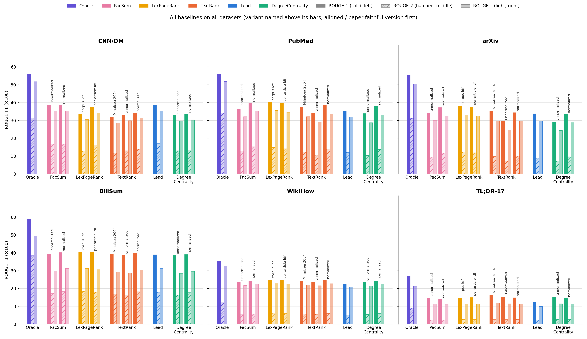

# Extractive summarization baselines across six datasets

Reproducible, verified implementations of the standard unsupervised extractive summarization
baselines (Lead, TextRank, DegreeCentrality, LexPageRank, PacSum, and a greedy Oracle), evaluated on
**CNN/DailyMail, PubMed, arXiv, BillSum, WikiHow and Webis-TLDR-17** with one shared pipeline.
Each baseline was checked against the numbers published in PacSum (Zheng & Lapata, 2019) and
HipoRank (Dong et al., 2021), and every remaining difference is documented.

Also included:
- **Robustness variants** (length-normalized similarity, per-article idf, the original TextRank),
  so no baseline is weakened by a setting chosen for a different domain.
- **A position analysis**: where summary-worthy sentences sit inside documents in each dataset.



## Results (ROUGE-1, F1 × 100)

| Baseline | CNN/DM | PubMed | arXiv | BillSum | WikiHow | TL;DR-17 |
|---|---|---|---|---|---|---|
| Oracle (upper bound) | 56.06 | 55.93 | 55.27 | 58.96 | 35.47 | 27.03 |
| Lead | 38.65 | 35.22 | 33.73 | 38.94 | 22.57 | 12.30 |
| TextRank (unnormalized / normalized / Mihalcea) | 33.14 / 34.27 / 31.97 | 34.20 / 38.48 / 37.64 | 29.47 / 34.39 / 35.36 | 38.63 / 39.88 / 39.28 | 23.69 / 24.63 / 24.23 | 15.41 / 14.89 / 16.43 |
| DegreeCentrality (unnormalized / normalized) | 32.96 / 33.56 | 33.86 / 37.91 | 29.10 / 33.37 | 38.48 / 39.00 | 23.56 / 24.39 | 15.38 / 14.59 |
| LexPageRank (corpus idf / per-article idf) | 33.58 / 37.39 | 40.24 / 39.59 | 37.93 / 37.65 | 40.57 / 40.19 | 24.91 / 24.66 | 14.66 / 14.98 |
| PacSum, tf-idf (unnormalized / normalized) | 38.67 / 38.54 | 36.40 / 39.63 | 34.31 / 37.23 | 39.35 / 40.16 | 23.53 / 24.37 | 14.75 / 13.96 |

Full ROUGE-1/2/L tables: [`results/summary.md`](results/summary.md) · comparison with published numbers:
[`results/alignment.md`](results/alignment.md) · how each baseline works and how it was tuned:
[`docs/BASELINES.md`](docs/BASELINES.md).

## Repository layout

```
baselines/                  Python code (all scripts import summarize.py, so keep them together)
  summarize.py              shared pipeline: dataset loading, sentence splitting, summary building,
                            ROUGE, hyperparameter tuning, parallel runs, command-line interface
  lead3.py                  Lead-k / first-N-words
  textrank.py               TextRank (Mihalcea 2004) + PacSum-style tf-idf graphs
  DegreeCentrality.py       degree centrality on the TextRank graph
  lexpagerank.py            LexPageRank (Erkan & Radev 2004); also continuous and sumy variants
  pacsum.py                 PacSum (tf-idf; BERT path implemented but untested)
  oracle.py                 greedy / exhaustive ROUGE oracle
  position_analysis.py      where Oracle and central sentences fall within documents
  collect_results.py        builds results/summary.md + summary.csv from all runs
  compare_published.py      builds results/alignment.md (ours vs PacSum / HipoRank)
  check_datasets.py         sanity-checks the downloaded data
slurm/
  download_datasets.sh      downloads the six datasets (Slurm job)
  run_baselines.sh          runs one dataset (MODE = main | sensitivity | pacsum_cosine)
  submit.sh                 submits run_baselines.sh for all datasets + the collector
  position_analysis.sh      position analysis job
  diagnostics/alignment_checks.sh   extra experiments used to explain differences from papers
scripts/export_results_from_hpc.sh  packages results (without predictions) for this repo
results/                    metrics, tuning choices and tables from our runs (no predictions)
docs/                       BASELINES.md and figures
config.example.sh           paths and Slurm account; copy to config.sh
```

## Quick start (Slurm cluster)

```bash
git clone https://github.com/<you>/<repo>.git && cd <repo>
python3 -m venv venv && source venv/bin/activate && pip install -r requirements.txt
cp config.example.sh config.sh      # set DATA_ROOT, VENV, SBATCH_ACCOUNT, ...
source config.sh

sbatch slurm/download_datasets.sh   # see "Data" below (WikiHow needs one manual download)
python baselines/check_datasets.py  # verify counts against the published sizes

bash slurm/submit.sh                # main baselines, all datasets in parallel
bash slurm/submit.sh sensitivity    # robustness variants
bash slurm/submit.sh pacsum_cosine  # PacSum on the normalized graph
sbatch slurm/position_analysis.sh   # optional

squeue -u $USER                     # monitor; logs are in ./logs/
cat results/summary.md results/alignment.md
```

Run everything from the repository root. Each dataset runs as its own job (16 CPUs, ≤ 12 h; most
finish within an hour, TL;DR-17 with 3.8 M posts takes longest). `SAMPLE_DOCS=100000 bash slurm/submit.sh`
evaluates a sample of WikiHow / TL;DR-17 instead.

## Without Slurm

The job scripts also run as plain bash, and every baseline is a command-line tool:

```bash
source config.sh
DATASET=cnn_dailymail bash slurm/run_baselines.sh          # one dataset, all main baselines

cd baselines
python lead3.py --dataset pubmed --split test --data-root "$DATA_ROOT" \
       --num-sentences 0 --word-limit 203 --no-rouge-stemmer --out ../results/test/lead
python lexpagerank.py --dataset arxiv --split test --data-root "$DATA_ROOT" \
       --num-sentences 0 --word-limit 220 --no-rouge-stemmer --tune --tune-split validation \
       --tune-docs 1000 --limit 500 --out ../results/test/lexpagerank
python textrank.py --help                                   # all options
```

Useful shared options: `--limit N` / `--offset N` (subset of documents), `--workers N`, `--tune`
(choose hyperparameters on development data), `--input FILE` (your own CSV/JSONL), `--order document`.

Each run folder contains:
- `predictions.jsonl`: one summary per document, with selected sentence indices, scores and per-document ROUGE
- `metrics.json`: average ROUGE, settings, data files, run time
- `tuning.json` (tuned methods): every setting tried, its validation score, and the one chosen

## Data

| Dataset | Source | Test documents |
|---|---|---|
| CNN/DailyMail | Kaggle `gowrishankarp/newspaper-text-summarization-cnn-dailymail` (needs a Kaggle API token) | 11,490 |
| PubMed, arXiv | Cohan et al. 2018 (`armancohan/long-summarization`) | 6,658 / 6,440 |
| BillSum | Hugging Face `FiscalNote/billsum` | 3,269 |
| WikiHow | `wikihowAll.csv` from [mahnazkoupaee/WikiHow-Dataset](https://github.com/mahnazkoupaee/WikiHow-Dataset), placed in `$DATA_ROOT/wikihow/manual/` by hand | 213,294 (after the 1,000 tuning documents) |
| Webis-TLDR-17 | Zenodo record 1043504 | 3,847,330 (after the 1,000 tuning documents) |

WikiHow and TL;DR-17 have no official splits: the first 1,000 documents are used for tuning and
evaluation starts after them.

## Adding your own method

A method is a module with a `Config` dataclass and a `score_sentences(sentences, cfg)` function that
returns one score per sentence; `summarize.cli` provides everything else (data loading, summary length,
ROUGE, tuning, parallelism). `lead3.py` is the smallest example. Use the same summary lengths, scoring
and tuning protocol as above so your numbers are comparable with this table.

## Notes

- ROUGE is computed without stemming everywhere; with stemming, Lead scores 1.5–2.5 ROUGE-1 higher than
  the published numbers it otherwise matches.
- `predictions.jsonl` files are not in the repository because of their size; rerun a baseline to
  regenerate them.
- PacSum's BERT version needs the authors' fine-tuned checkpoint (see their repository) and a GPU.

## References

- Mihalcea & Tarau (2004), *TextRank: Bringing Order into Texts*; Mihalcea (2004), graph-based ranking for sentence extraction.
- Erkan & Radev (2004), *LexPageRank: Prestige in Multi-Document Text Summarization*; *LexRank* (JAIR 2004).
- Zheng & Lapata (2019), *Sentence Centrality Revisited for Unsupervised Summarization* (PacSum).
- Dong, Mircea & Cheung (2021), *Discourse-Aware Unsupervised Summarization for Long Scientific Documents* (HipoRank).
- Nallapati, Zhai & Zhou (2017), *SummaRuNNer* (greedy oracle).
- Řehůřek & Sojka (2010), *Software Framework for Topic Modelling with Large Corpora* (gensim).
